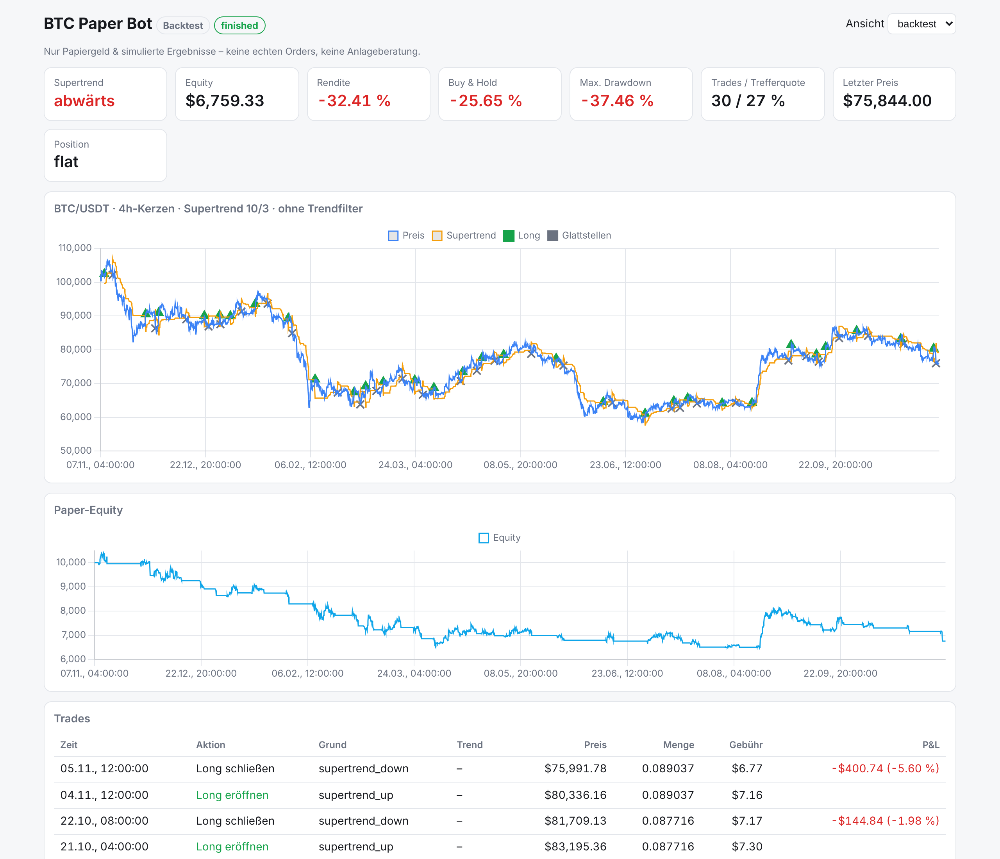

# BTC Paper-Trading-Bot

Ursprünglich ein Nachbau des Videos „Crypto Trading Bot with AI: The $10K Challenge“ (MA-Crossover, Dashboard, CoinGecko-Preise, Backtest, Forward-Test).
Die Standard-Strategie ist inzwischen der Sieger eines Vergleichs von 22 bekannten BTC-Strategien (siehe [Strategie-Vergleich](#strategie-vergleich)): **Supertrend 10/3 auf 4h-Kerzen**.

- **Dashboard** mit Paper-Equity, Preis-Chart, Indikator-Linie, Kauf/Verkauf-Markern und Trade-Liste
- **Live-Preise** über die CoinGecko-API (REST kostenlos, WebSocket mit bezahltem Key)
- **Backtest** auf CoinGecko- oder Binance-Historie (Binance: Jahre an Kerzen, kostenlos, ohne Key)
- **Forward-Test** live mit Papiergeld, Konto übersteht Neustarts

> ⚠️ **Nur Papiergeld.** Der Bot sendet keine echten Orders und hat keinen Börsenzugang. Alle Ergebnisse sind simuliert. Keine Anlageberatung.



## Handelsregeln (Standard)

**Supertrend 10/3 auf 4h-Kerzen, nur Long:**

1. **Kaufen**, sobald eine 4h-Kerze über der oberen Supertrend-Linie schließt (Trend dreht nach oben) und das Konto flat ist.
2. **Glattstellen**, sobald eine 4h-Kerze unter der unteren Supertrend-Linie schließt (Trend dreht nach unten).

Der Supertrend ist eine Linie im Abstand von 3 × ATR(10) (durchschnittliche Schwankungsbreite der letzten 10 Kerzen) unter bzw. über dem Kurs, die nur in Trendrichtung nachgezogen wird.
Sonst nichts: keine Shorts, kein Stop-Loss, kein höherer Zeitrahmen.

- Einzige Absicherung ist der Not-Aus bei 50 % Verlust vom Höchststand (`--max-drawdown`). Das liegt jenseits des schlimmsten Backtest-Verlusts (−47 %) und greift nur, wenn etwas grundlegend schiefläuft. `--max-drawdown 100` schaltet ihn ab.
- Nach einem Neustart lädt der Bot 250 echte 4h-Kerzen von Binance vor. Zeigt der Supertrend dann nach oben und das Konto ist flat, kauft er beim nächsten Kerzenschluss.
- Die alten Varianten gibt es weiter, z. B. `--strategy ma --fast 9 --slow 21 --candle-seconds 300 --trend` (5-min MA-Cross mit 1h-Trendfilter).

## Schnellstart

```bash
cd btc-bot
pip install -r requirements.txt

# Backtest der Standard-Strategie: 365 Tage, 4h-Kerzen (Daten automatisch von Binance)
python -m bot backtest --dashboard

# längerer Zeitraum
python -m bot backtest --days 1800

# Forward-Test mit Live-Preisen (REST, kostenlos) und Dashboard auf http://127.0.0.1:8000
python -m bot paper --dashboard

# kompletter Strategie-Vergleich (lädt vorher die 1h-Historie seit 2017, siehe unten)
python research/strategy_tournament.py data/btcusdt_1h.csv
```

Nur das Dashboard starten: `python -m bot dashboard`. Oben rechts lässt sich zwischen `backtest` und `paper` umschalten.

## Wichtige Optionen

| Option | Standard | Bedeutung |
|---|---|---|
| `--strategy` | `supertrend` | `supertrend` oder `ma` (Moving-Average-Crossover) |
| `--atr-period` / `--multiplier` | 10 / 3 | Supertrend-Parameter |
| `--fast` / `--slow` / `--ma` | 9 / 21 / `sma` | nur `--strategy ma`: MA-Längen und -Typ |
| `--trend` | aus | Käufe nur bei bullischem Trend auf höherem Zeitrahmen |
| `--trend-interval` / `--trend-fast` / `--trend-slow` / `--trend-ma` | 3600 / 9 / 21 / `ema` | Einstellungen für `--trend` |
| `--allow-short` | aus | mit `--trend`: auch Shorts im bärischen Trend |
| `--cash` | 10000 | Start-Kapital (Papier) |
| `--fee` / `--slippage` | 0.1 / 0.05 | Gebühr und Slippage pro Ausführung in % |
| `--stop-loss` / `--take-profit` | aus | optionale Stops in % |
| `--max-drawdown` | 50 | Not-Aus: Bei diesem Verlust vom Höchststand wird verkauft und der Handel gestoppt |
| `--fraction` | 100 | Anteil des Cash pro Einstieg in % |
| `--days` / `--interval` | 365 / 14400 | Backtest-Zeitraum und Kerzenlänge in Sekunden |
| `--data` / `--symbol` | `auto` / `BTCUSDT` | Backtest-Daten: `coingecko`, `binance` oder `auto` (Binance, wenn CoinGecko zu grob ist) |
| `--source` | `rest` | `rest` (kostenlos) oder `ws` (WebSocket, bezahlt) |
| `--candle-seconds` | 14400 | Signal-Kerzenlänge im Forward-Test |
| `--reset` | – | gespeichertes Paper-Konto verwerfen |

CoinGecko-Granularität: `--days 1` liefert ~5-Minuten-Daten, 2–90 Tage stündliche, mehr als 90 Tage tägliche Daten.
Wo das zu grob ist, holt der Bot automatisch die kostenlosen Kerzen von Binance (`data-api.binance.vision`, kein Key nötig, BTC/USDT).
Der Live-Forward-Test nutzt für Preise CoinGecko, für das Vorladen der Kerzen Binance (echte Hochs/Tiefs, die der Supertrend braucht).
Live entstehen Hoch und Tief einer Kerze aus den abgefragten Preisen (alle 30 s). Sie liegen daher minimal enger als die echten Werte.
Die öffentliche API ist stark limitiert. Mit `--poll` unter ~15 s kommen schnell HTTP-429-Antworten; der Bot wartet dann automatisch und versucht es erneut.
Ein kostenloser **Demo-Key** (`COINGECKO_PLAN=demo`) erhöht das Limit.
Die REST-Preise aktualisiert CoinGecko nur etwa alle 20–60 s. Für kurze Kerzen ist deshalb die WebSocket-Quelle gedacht.

## Dauerbetrieb (Docker)

```bash
cp .env.example .env      # optional: Key eintragen
docker compose up -d --build
docker compose logs -f
```

- `restart: unless-stopped` startet den Bot nach einem Absturz oder Reboot neu.
- Das Paper-Konto liegt in `data/paper_account.json` und wird nach jedem Trade gespeichert. Nach einem Neustart macht der Bot dort weiter.
- Der Healthcheck markiert den Container als `unhealthy`, wenn der Status länger als 5 Minuten nicht aktualisiert wurde.
- Das Dashboard ist nur lokal erreichbar (`127.0.0.1:8000`). Für Zugriff von außen einen SSH-Tunnel nutzen, den Port nicht offen ins Internet stellen.

## Aufbau

```
bot/
  coingecko.py  REST-Client (Retry/Backoff bei 429) + WebSocket-Stream
  candles.py    Ticks → Kerzen (füllt Lücken mit flachen Kerzen)
  strategy.py   Supertrend und SMA/EMA-Crossover
  broker.py     Paper-Konto (Long, optional Short): Gebühren, Slippage, Trade-Log
  engine.py     Signale + optionaler Trendfilter + Konto, identisch für Backtest und Live
  binance.py    historische Kerzen von Binance (Backtest, Warm-up)
  backtest.py   Backtest, Parameter-Raster, CSV-Export
  live.py       Forward-Test (REST-Polling oder WebSocket mit Reconnect)
  dashboard.py  kleiner Webserver (nur Standardbibliothek)
dashboard/index.html  Dashboard (Chart.js)
research/strategy_tournament.py  Vergleich von 22 Strategien (2018–heute)
tests/        pytest-Tests (python -m pytest)
```

Backtest und Forward-Test nutzen dieselbe `TradingEngine`. Live-Ergebnisse sind dadurch direkt mit dem Backtest vergleichbar.

## Strategie-Vergleich

Recherche (Nov. 2026) nach den bekanntesten BTC-Strategien, dann ein eigener Backtest aller Kandidaten unter gleichen Bedingungen:
BTC/USDT von Binance, **01.01.2018 bis 06.11.2026** (8,8 Jahre), nur Long, 0,15 % Kosten pro Positionswechsel, Signal auf Kerzenschluss, Standardparameter ohne Optimierung.
In-Sample 2018–2021, Out-of-Sample (OOS) 2022–2026. Code: `research/strategy_tournament.py`.

| Strategie | CAGR | Max. Drawdown | Calmar | Trades | OOS CAGR |
|---|---|---|---|---|---|
| Donchian 20/10 + ADX>25 (1D) | +26 % | −37 % | 0,70 | 27 | +4 % |
| Donchian 20/10 Turtle (1D) | +34 % | −54 % | 0,63 | 42 | +7 % |
| **Supertrend 10/3 (4h)** | **+29 %** | **−46 %** | **0,63** | 216 | **+10 %** |
| EMA 9/21 Cross (1D) | +33 % | −61 % | 0,54 | 65 | +12 % |
| EMA 20/50 Cross (1D) | +31 % | −66 % | 0,48 | 26 | +11 % |
| Momentum 30 Tage (1D) | +32 % | −71 % | 0,45 | 136 | +16 % |
| MACD 12/26/9 (1D) | +24 % | −54 % | 0,45 | 117 | +7 % |
| Kurs > SMA 200 (1D) | +24 % | −64 % | 0,38 | 33 | +27 % |
| **Buy & Hold** | **+22 %** | **−81 %** | 0,27 | 1 | +10 % |
| Golden Cross 50/200 (1D) | +17 % | −67 % | 0,26 | 10 | +10 % |
| SMA 21/50 Cross (4h) | +14 % | −70 % | 0,20 | 222 | +5 % |
| Connors RSI-2 (1D) | +5 % | −34 % | 0,14 | 72 | +9 % |
| RSI 14 30/70 (1D) | +4 % | −66 % | 0,07 | 13 | +3 % |
| MACD (4h) | −3 % | −79 % | −0,04 | 727 | −15 % |
| Bollinger Mean Reversion (1D) | −5 % | −71 % | −0,07 | 51 | +0 % |
| SMA 9/21 Cross (1h) | −32 % | −98 % | −0,33 | 2.130 | −41 % |
| Saisonalität 21–23 UTC (1h) | −57 % | −100 % | −0,57 | 3.231 | −61 % |

(Weitere getestete Varianten: Donchian 55/20, Supertrend 1D, Momentum 90, Bollinger Breakout, Saisonalität mit Trendfilter. Vollständige Liste und Jahresrenditen liefert das Skript.)

**Warum Supertrend 4h und nicht Platz 1:** Donchian + ADX ist nur mit genau ADX > 25 gut. Mit ADX > 20 oder > 30 wird er im OOS-Zeitraum negativ, und das Ergebnis schwankt stark je nach Uhrzeit des Tagesschlusses. Das ist ein typisches Zeichen für Zufall.
Supertrend 4h liefert dagegen mit allen Nachbarparametern (ATR 10–14, Faktor 3–4) ähnliche Werte (Calmar 0,62–0,69, OOS +10 bis +13 %) und hängt nicht vom Tagesschluss ab.

**Ehrlich dazu:**
- Über 8,8 Jahre schlägt Supertrend 4h Buy & Hold (+29 % statt +22 % pro Jahr) bei deutlich kleinerem Maximalverlust (−46 % statt −81 %), vor allem weil er die großen Crashs 2018 und 2022 großteils meidet.
- **Die letzten 12 Monate (Nov. 2025–Nov. 2026) waren schlecht:** −32 % gegenüber −26 % für Buy & Hold. Im Seitwärts-/Abwärtsmarkt gibt es viele Fehlsignale. Am besten liefen in diesen 12 Monaten EMA 9/21 auf Tageskerzen (+10 %) und Kurs > SMA 200 (+9 %).
- Mean-Reversion-Strategien (RSI, Bollinger) und alles auf 1h oder kürzer verlieren mit realistischen Gebühren deutlich. Das deckt sich mit den Quellen unten.

Quellen der Recherche: [Quantpedia: Seasonality of Bitcoin](https://quantpedia.com/the-seasonality-of-bitcoin/), [Quantpedia: Trend-following und Mean-Reversion in Bitcoin](https://quantpedia.com/Blog/page/29/?Page=8), [49 Krypto-Strategien im Backtest (dev.to)](https://dev.to/maymay5692/i-backtested-49-crypto-trading-strategies-heres-every-single-result-4gg5), [Quantified Strategies: Donchian/ADX auf BTC](https://quantifiedstrategies.substack.com/p/how-chatgpt-helped-us-make-a-bitcoin), [Death-Cross-Studie](https://crypto-threads-five.vercel.app/post/bitcoin-death-cross-a-data-driven-performance-study), [MACD 4h vs. HODL (KuCoin)](https://www.kucoin.com/news/flash/macd-backtest-reveals-4h-strategy-outperforms-hodling-in-5-year-crypto-analysis), [RSI vs. HODL (bgeometrics)](https://bgeometrics.com/2022/01/08/bitcoin-it-is-better-to-follow-the-rsi-or-buy-and-hodl-hodl).

Historie für das Vergleichs-Skript laden (einmalig, ~80.000 Stundenkerzen):

```bash
python -c "import sys,time,csv,calendar; sys.path.insert(0,'.'); from bot.binance import fetch_klines; \
c=fetch_klines('BTCUSDT',3600,calendar.timegm((2017,8,17,0,0,0)),time.time()); w=csv.writer(open('data/btcusdt_1h.csv','w',newline='')); \
w.writerow(['t','o','h','l','c']); [w.writerow([x.start,x.open,x.high,x.low,x.close]) for x in c]"
```

## Frühere Tests (MA-Crossover)

Ein einfacher MA-Crossover ist in Seitwärtsphasen anfällig für viele Fehlsignale, und Gebühren fressen die Gewinne.
- Ohne Trendfilter, 30 Tage (Okt./Nov. 2026, 1h-Kerzen, SMA 9/21): **−14 %**, Buy & Hold **−9 %**.
- Mit 4h-Trendfilter und Shorts, 5-min-Kerzen, letzte 24 h (06.11.2026): **−4 %** bei 7 Trades (0 Gewinner), Buy & Hold **+0,1 %**.
- Aktuelle Regeln (1h-Trend, nur Long), dieselben 24 h: **0 Trades, ±0 %**. Der 1h-Trend war den ganzen Tag bärisch, alle 8 Golden Crosses wurden gefiltert.
- **Aktuelle Regeln, 30 Tage (07.10.–06.11.2026, Binance 5-min):** **−20,2 %**, Buy & Hold **−9,0 %**. 60 Trades, 10 % Gewinner, 1.077 $ Gebühren. Am 25.10. hat der Not-Aus ausgelöst. Ohne Not-Aus wären es −28,9 % bei 98 Trades gewesen.
  - Ohne Gebühren und Slippage: −4,6 %. Die Signale haben also schon vor Kosten keinen Vorteil, und die Kosten von ~0,3 % pro Runde vervielfachen den Verlust.
  - Langsamere Einstellungen verlieren weniger: 5-min SMA 30/100 −5,4 % (17 Trades), 1h-Filter EMA 50/200 −8,1 % (21 Trades). Keine Variante war über diese 30 Tage im Plus.
Bevor echtes Geld ins Spiel kommt:

- Mit `--sweep` prüfen, ob auch *benachbarte* Einstellungen funktionieren, nicht nur die beste Zeile (sonst Overfitting).
- Mehrere Zeiträume testen (Bullen-, Bären-, Seitwärtsmarkt).
- Wochenlang im Forward-Test laufen lassen und mit dem Backtest vergleichen.
- Die installierten Claude-Skills `backtest-expert`, `walk-forward-validation` und `risk-management` helfen dabei.
